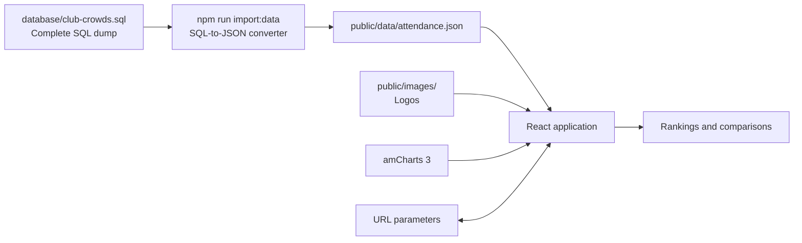

# Club Crowds

### Get started

**Requirements:** Node.js 20.19+ within the 20.x release line, or Node.js 22.12+; npm. PHP is only needed for the optional Transfermarkt importer.

```bash
# From the project directory
npm ci
npm run dev
```

Open the local address printed by Vite. The included dataset and images are enough to run the site; no database connection is required.

```bash
# Create a production build in dist/
npm run build

# Preview the production build locally
npm run preview
```

### Deploy to a static web host

Run `npm run build`, then upload the **contents** of `dist/` to the target web directory. For example, for `https://example.com/club-crowds/`, place `dist/index.html`, `dist/assets/`, `dist/data/`, `dist/images/`, and `dist/vendor/` inside the server's `club-crowds/` directory. The build uses relative asset paths, so it works in a subdirectory as well as at the domain root. Do not upload the source `index.html` as the live page: the browser needs the compiled output generated by Vite.

---

**ClubCrowds: Football Attendance History & Comparisons**

Club Crowds is an experimental React refactor of a PHP and jQuery football attendance project. Explore how crowds change over time, compare clubs and leagues, and find the biggest attendances in a given season.

## Features

- **Seasonal top 50:** rank clubs across the available leagues by average attendance or stadium occupancy.
- **Club comparisons:** compare up to 10 clubs on an attendance or occupancy line chart.
- **League comparisons:** compare up to six leagues over a selected season range.
- **Shareable comparison URLs:** selected clubs or leagues, seasons, and metric are stored in the address bar.
- **Club and league images:** use the images referenced by the historical dataset, with a placeholder when one is missing.
- **No database needed to browse:** the React app reads a static JSON dataset.

Charts use the original project's **amCharts 3** library. The frontend is built with **React** and **Vite**.

## How the system works



`database/club-crowds.sql` is the source dataset. A Node.js script reads its SQL statements as text and writes `public/data/attendance.json`. The browser fetches that JSON and calculates the rankings and comparisons locally. **The React application does not execute SQL or connect to MySQL.**

The dump contains the original schema and historical data through 2026/27. The 2026/27 snapshot was collected on **5 November 2026**, while that season was in progress.

## Import and update data

### Regenerate the frontend dataset

After changing `database/club-crowds.sql`, run:

```bash
npm run import:data
```

This reads the four tables in the SQL dump and rewrites `public/data/attendance.json`. League country names are translated into English in the JSON. Restarting the database is not necessary: the script does not connect to one.

The converter expects the dump's MySQL-style ``INSERT INTO `table` (...) VALUES (...)`` format for `clubs`, `league`, `clubdata`, and `leaguedata`. It **does not execute** SQL statements or apply `UPDATE` and `INSERT ... SELECT` statements. If the server database changes, export a complete compatible SQL dump to `database/club-crowds.sql`, then run the command above. Updating a server database alone does not update the static site.

### Use the SQL on a server

Import `database/club-crowds.sql` into an **empty** MySQL or MariaDB database using your preferred database tool. The dump preserves the legacy table structure and IDs. It uses MyISAM tables, so changes cannot be rolled back as transactions; back up any existing database first. The SQL import has not been tested against a local database.

### Fetch newer Transfermarkt data

The optional PHP command reads a Transfermarkt attendance page and generates SQL; it does not connect to a database:

```bash
# league=1 is Bundesliga; season=2026 means 2026/27
php scripts/transfermarkt.php --league=1 --season=2026 > update.sql
```

PHP needs the **cURL** and **DOM** extensions. League IDs are listed in [`scripts/transfermarkt.php`](scripts/transfermarkt.php). Use `--html=page.html` to parse a saved page, or `--json` to output the parsed data as JSON.

Review the generated SQL before applying it to the server. Club matching relies on names, and Transfermarkt markup can change. After applying an update, export a complete dump and regenerate the frontend JSON as described above. The `--insecure` option disables certificate verification for that request; configuring a trusted CA is preferable. Check the source site's terms and rate limits before fetching data.

### Refresh images

```bash
npm run import:images
```

This copies images referenced by the dataset from `old-project/images/` into `public/images/` and updates the image manifest. The command requires the legacy folder, which is intentionally ignored by Git. The existing public images are sufficient to run the site; missing images use a placeholder.

## Project structure

```text
club-crowds/
├── database/
│   └── club-crowds.sql       # Complete historical SQL dump
├── public/
│   ├── data/attendance.json  # Dataset served to the browser
│   ├── images/               # Referenced logos and manifest
│   └── vendor/amcharts/      # Original amCharts 3 files
├── scripts/
│   ├── import-sql.mjs        # Complete SQL dump → frontend JSON
│   ├── import-images.mjs     # Legacy images → public images
│   └── transfermarkt.php     # Transfermarkt → SQL or JSON
├── src/
│   ├── main.jsx              # React screens and charts
│   ├── comparison-url.js     # Comparison URL state
│   ├── top-clubs.js          # Seasonal top-50 ranking
│   ├── club-leagues.js       # Latest recorded league per club
│   ├── attendance-value.js   # Missing-value display rules
│   └── *.css                 # Application styles
├── index.html
└── package.json
```

## Data notes

- The historical database does not consistently distinguish missing values from genuine zero attendance. The interface treats zero attendance and occupancy as **No data**, excludes them from the top 50, and leaves gaps in line charts. The source values remain unchanged.
- Team and league names and logos come from the historical data. Some images are unavailable locally.
- A comparison URL can look like `?compare=clubs&ids=1,2&from=1920&to=2627&metric=percentage`. Opening it restores the comparison; browser back and forward navigate through changes.
- A ranking URL can look like `?compare=top50&season=2627&metric=average`. The selected season and metric are restored when the link is opened.
- This is an experimental project, and source data may be incomplete or change as a season progresses.

## Third-party assets

The project includes the original amCharts 3 files and club and league images. Review the applicable amCharts license and image rights before publishing or using them commercially. Attendance data is sourced from Transfermarkt; review its terms before collecting or redistributing data.
